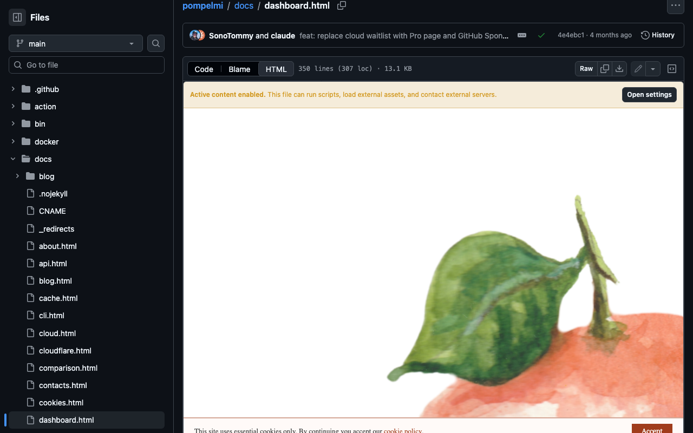

# Native HTML Preview for GitHub

<p align="center">
  
</p>

Preview repository HTML files inside [GitHub](https://github.com) without a
download, API token, or third-party renderer.

The extension adds **HTML** beside GitHub's **Code** and **Blame**
controls. The preview replaces only the source section, so commit details, file
statistics, and native controls stay visible.



## Contents

- [Install](#install)
- [Features](#features)
- [Security model](#security-model)
- [Permissions](#permissions)
- [Load unpacked](#load-unpacked)
- [Development](#development)
- [Project structure](#project-structure)
- [Independence](#independence)
- [License](#license)

## Install

Install [Native HTML Preview for GitHub from the Chrome Web Store](https://chromewebstore.google.com/detail/native-html-preview-for-g/eogkbedpfhpdjlbmehjfigaehdaieaca).

## Features

- Supports `.html`, `.htm`, and `.xhtml` files on blob and blame pages.
- Works with public and private files already visible in the current session.
- Keeps preview state in the URL with `?native-html=preview`.
- Resolves relative assets from the file's raw URL.
- Runs inline and HTTPS-hosted scripts in an isolated frame by default.
- Loads HTTPS styles, images, fonts, media, and API requests by default.
- Provides Chrome side-panel settings for restricted previews and warning visibility.
- Uses no API token, extra account, or runtime dependency.

## Security model

Repository HTML runs in a sandboxed iframe with an opaque origin. It cannot read
GitHub cookies, storage, DOM, or extension APIs. Frames, objects, forms, popups,
and top-level navigation remain blocked.

Active mode is the default because most HTML documents depend on external
assets. By default, a warning above active previews states that the file can run
scripts and contact external servers. The side panel can hide this warning
without changing the sandbox. Only preview active HTML you trust, especially in
private repositories.

Turn off **Allow active content** in Chrome's extension side panel for restricted
mode. Restricted previews remove JavaScript and block external network access;
inline styles and embedded `data:` or `blob:` assets still render.

The extension validates raw source URLs against the current repository and
rejects HTML larger than 5 MB.

## Permissions

- `storage` remembers the active-content setting.
- `sidePanel` shows that setting in Chrome's native side panel.
- Access to `github.com` adds the preview control and reads the current file.

No repository content is stored through the `storage` permission.

## Load unpacked

1. Run `npm ci --ignore-scripts`.
2. Run `npm run build`.
3. Open `chrome://extensions`.
4. Enable **Developer mode**.
5. Click **Load unpacked**.
6. Select `dist/extension`.
7. Open an HTML file on GitHub and click **HTML**.

Reload the extension and refresh GitHub after changing source files.

## Development

Install pinned development tools and run formatting, linting, type checks, unit
tests, and browser tests:

```sh
nvm use
npm ci --ignore-scripts
npx --no-install playwright install chromium
npm run check
```

Run the opt-in smoke test against the current public GitHub UI with
`npm run test:live`.

See [`CONTRIBUTING.md`](CONTRIBUTING.md) for browser checks and
[`SECURITY.md`](SECURITY.md) for private vulnerability reporting.

Build a deterministic Chrome Web Store ZIP from a clean commit:

```sh
npm run package
```

The package and its SHA-256 checksum are written under `dist/`.

## Project structure

- [`manifest.json`](manifest.json) defines the Manifest V3 extension.
- [`brand.json`](brand.json) defines the colors, standard palette, and logo.
- [`src/content.ts`](src/content.ts) coordinates GitHub navigation, settings, and
  preview lifecycle.
- [`src/github-source.ts`](src/github-source.ts) reads and validates the current
  repository file.
- [`src/preview-security.ts`](src/preview-security.ts) hardens documents and
  defines mode-specific Content Security Policy.
- [`src/preview-view.ts`](src/preview-view.ts) owns the source swap and trusted
  UI around the sandbox.
- [`sidepanel/sidepanel.ts`](sidepanel/sidepanel.ts) owns the active-content
  setting.
- [`test/e2e`](test/e2e) exercises the built extension in Chromium.
- [`scripts/build.mjs`](scripts/build.mjs) creates the unpacked extension.
- [`scripts/package.sh`](scripts/package.sh) creates the release ZIP.
- [`STORE_LISTING.md`](STORE_LISTING.md) contains Chrome Web Store copy and
  submission fields.
- [`PRIVACY_POLICY.md`](PRIVACY_POLICY.md) documents data handling.

## Independence

Native HTML Preview for GitHub is an independent project. It is not affiliated
with, sponsored by, or endorsed by GitHub, Inc. GitHub is a trademark of GitHub,
Inc.

## License

[MIT](LICENSE)
